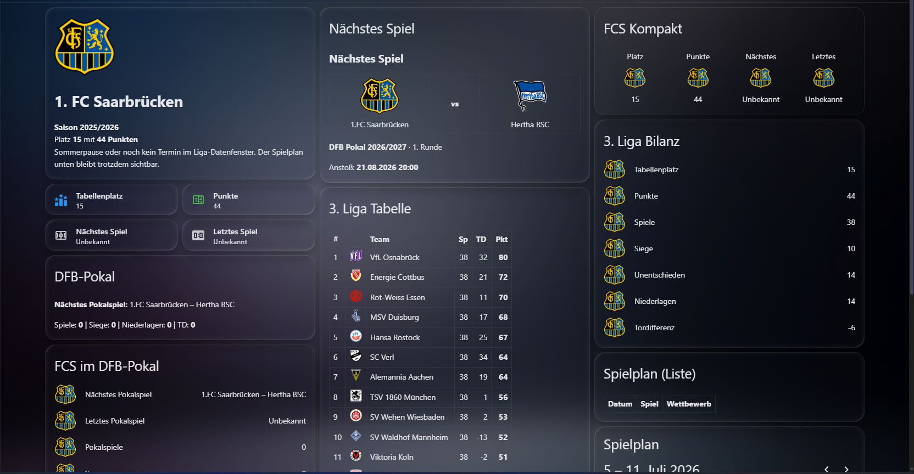

# OpenLigaDB Team Tracker für Home Assistant


[](https://my.home-assistant.io/redirect/hacs_repository/?owner=Saarlandpower&repository=ha-openligadb-team&category=integration)

Verfolge deinen Verein aus **Bundesliga, 2. Bundesliga, 3. Liga, DFB-Pokal** und allen anderen Ligen, die [OpenLigaDB](https://www.openligadb.de) abdeckt — inklusive Tabelle, nächstem Spiel, letztem Ergebnis und Spielplan. Kein API-Key nötig.

Entstanden, weil ESPN/TeamTracker die 3. Liga nicht unterstützt. ⚽💙🖤



## Features

- **Config Flow**: Liga-Kürzel eingeben (z.B. `bl3`), Verein per Dropdown wählen
- **6 Sensoren pro Verein**:
  | Sensor | Inhalt |
  |---|---|
  | Tabellenplatz | Platzierung, plus Bilanz (S/U/N, Tore, Differenz) als Attribute |
  | Punkte | Aktuelle Punktzahl |
  | Nächstes Spiel | Paarung, Anstoß (UTC + lokal), Spieltag, Wettbewerb |
  | Letztes Spiel | Paarung mit Endergebnis |
  | Spiele | Alle Spiele der letzten 3 / nächsten 5 Wochen — **inkl. Pokalspiele** |
  | Tabelle | Komplette Ligatabelle als Attribut |
- **Saisonwechsel automatisch** (Juli-Logik), in der Sommerpause wird die Abschlusstabelle der Vorsaison angezeigt
- **Teamlogo inklusive**: Die Sensoren liefern das Vereinslogo als `entity_picture` und als Attribut `team_logo`
- Mehrere Vereine/Ligen parallel möglich (je ein Config Entry)
- **Live-Modus**: Während eines Spiels wird jede Minute aktualisiert, sonst passt sich das Intervall automatisch an (siehe unten)
- **Events für Automationen**: Anpfiff, Tore und Abpfiff lösen eigene Events aus

## Installation (HACS)

1. HACS → Integrationen → ⋮ → **Custom Repositories**
2. Repository: `https://github.com/Saarlandpower/ha-openligadb-team` — Kategorie: **Integration**
3. **OpenLigaDB Team Tracker** installieren
4. Home Assistant neu starten
5. Einstellungen → Geräte & Dienste → **Integration hinzufügen** → "OpenLigaDB Team Tracker"
6. Liga-Kürzel eingeben (`bl3` für die 3. Liga), Verein wählen — fertig

## Live-Modus

Das Abfrageintervall richtet sich nach dem Spielplan deines Vereins:

| Situation | Intervall |
|---|---|
| Spiel läuft | jede Minute (nur das laufende Spiel wird abgefragt, Tabelle alle 15 Min.) |
| Anstoß in weniger als 15 Min. | Update genau zum Anstoß |
| Spiel in den nächsten 12 h oder vor weniger als 6 h | alle 15 Minuten |
| sonst | stündlich |

Während eines Spiels haben die Spiele im Sensor *Nächstes Spiel* bzw. *Spiele* die Attribute `live: true` und `live_score` (z. B. `1:0`).

## Events für Automationen

| Event | Wann | Wichtige Daten |
|---|---|---|
| `openligadb_team_match_started` | Anpfiff | `home`, `away`, `competition`, `team_side` |
| `openligadb_team_goal` | Tor | `score`, `minute`, `scorer`, `scoring_team`, `for_team`, `penalty`, `own_goal` |
| `openligadb_team_match_ended` | Abpfiff | `score`, `result` (`won` / `draw` / `lost`) |

Alle Events enthalten außerdem `team`, `entry_id`, `league_shortcut`, `match_id`, `matchday`, `score_home` und `score_away`. `for_team` ist `true`, wenn das Tor für deinen Verein fiel – auch bei Eigentoren des Gegners.

Nach einem Neustart von Home Assistant werden bereits gefallene Tore nicht erneut gemeldet. Wie schnell ein Tor ankommt, hängt davon ab, wie schnell es bei OpenLigaDB eingetragen wird (Community-gepflegt, meist wenige Minuten).

### Beispiel: Push-Nachricht bei einem Tor des eigenen Vereins

```yaml
automation:
  - alias: "Tor für meinen Verein"
    triggers:
      - trigger: event
        event_type: openligadb_team_goal
        event_data:
          team: "1. FC Saarbrücken"
          for_team: true
    actions:
      - action: notify.mobile_app_mein_handy
        data:
          title: "⚽ TOR! {{ trigger.event.data.score }}"
          message: >-
            {{ trigger.event.data.scorer }} ({{ trigger.event.data.minute }}.)
            – {{ trigger.event.data.home }} gegen {{ trigger.event.data.away }}
```

### Beispiel: Endergebnis melden

```yaml
automation:
  - alias: "Abpfiff"
    triggers:
      - trigger: event
        event_type: openligadb_team_match_ended
    actions:
      - action: notify.mobile_app_mein_handy
        data:
          title: >-
            {{ {'won': 'Sieg! 🎉', 'draw': 'Unentschieden', 'lost': 'Niederlage'}[trigger.event.data.result] | default('Abpfiff') }}
          message: "{{ trigger.event.data.home }} {{ trigger.event.data.score }} {{ trigger.event.data.away }}"
```

## Gängige Liga-Kürzel

`bl1` (Bundesliga), `bl2` (2. Bundesliga), `bl3` (3. Liga), `dfb` (DFB-Pokal). Weitere unter [openligadb.de](https://www.openligadb.de).

## Wie erstelle ich daraus eine Karte in Home Assistant?

Sobald du einen Verein hinzugefügt hast, legt die Integration pro Team **6 Sensoren** an. Danach geht es in Lovelace so weiter:

1. Dashboard öffnen
2. Oben rechts auf **Bearbeiten**
3. **Karte hinzufügen**
4. **Manuell** auswählen
5. Eines der YAML-Beispiele aus [`examples/lovelace_cards.yaml`](examples/lovelace_cards.yaml) einfügen
6. Die Beispiel-Entities wie `sensor.1_fc_saarbrucken_tabelle` auf deine eigenen Entity-IDs anpassen

Die Entity-IDs findest du unter **Entwicklerwerkzeuge → Zustände**, wenn du nach `openligadb`, deinem Vereinsnamen oder `tabelle` suchst.

Zusätzlich stellen die Sensoren das Teamlogo direkt als **`entity_picture`** bereit. Damit kannst du es ohne Zusatz-API direkt in `picture-entity`, Mushroom-Karten oder anderen Lovelace-Karten verwenden.

## Beispiel: Tabellen-Card (Markdown)

```yaml
type: markdown
content: |
  ## 3. Liga {{ state_attr('sensor.1_fc_saarbrucken_tabelle', 'season') }}/{{ (state_attr('sensor.1_fc_saarbrucken_tabelle', 'season') or 0) + 1 }}
  | # | Team | Sp | TD | Pkt |
  |---|------|----|----|----|
  
  | {{ t.position }} | **{{ t.team }}**{{ t.team }} | {{ t.matches }} | {{ t.goal_diff }} | **{{ t.points }}** |
  
```

## Weitere Lovelace-Beispiele

Fertige Beispiele für typische Karten findest du hier:

- [`examples/lovelace_cards.yaml`](examples/lovelace_cards.yaml)

Enthalten sind unter anderem:

- kompakte Team-Übersicht
- Logo-Karte für den Verein
- Karte für das nächste Spiel
- Karte für das letzte Spiel
- Spielplan der kommenden und vergangenen Partien
- Tabellenansicht als Markdown-Karte

## Hinweise

- Datenquelle: [api.openligadb.de](https://api.openligadb.de) — Community-gepflegt, Live-Zwischenstände können je nach Liga verzögert sein
- Update-Intervall: 15 Minuten
- Dieses Projekt steht in keiner Verbindung zu OpenLigaDB, der DFL oder dem DFB

## ☕ Support Development

Wenn dir dieses Projekt gefällt und du die Weiterentwicklung unterstützen möchtest:

[](https://ko-fi.com/saarmesh)

Deine Unterstützung hilft bei Entwicklung, Tests, Bugfixes und neuen Features.

## Lizenz

MIT
